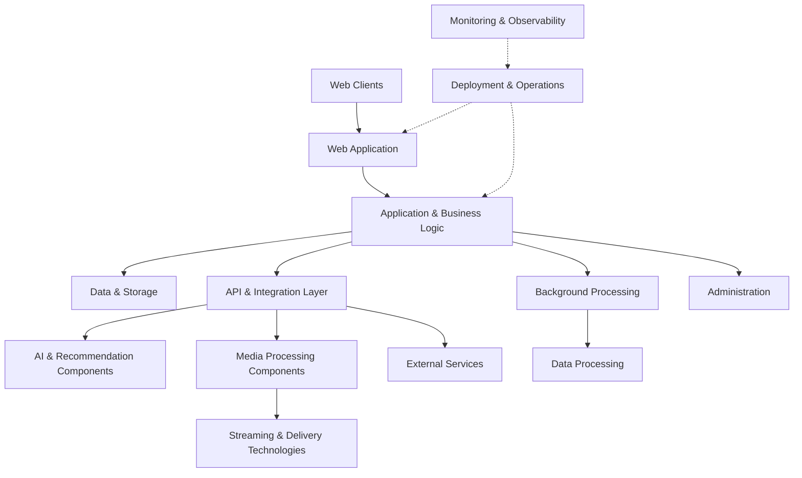

# RocoShop

### Polyglot Digital Commerce Platform

**A multi-technology software platform combining digital commerce, intelligent systems, media processing, distributed technologies, and production engineering.**

---

## Overview

RocoShop is a digital commerce and software platform developed to manage, publish, and distribute digital products through an integrated web environment.

Originally developed with PHP, the project has evolved into a polyglot codebase incorporating multiple programming languages, application frameworks, machine learning technologies, media-processing tools, and infrastructure integrations.

Laravel remains part of the application foundation, while additional technologies support specialized functionality across different parts of the system.

The project covers application engineering, API development, frontend interfaces, data processing, automation, security, infrastructure integration, and production operations.

**Engineering focus:** Polyglot architecture, system integration, performance, security, automation, and long-term maintainability.

## Platform Capabilities

| Area | Capabilities |
|---|---|
| Digital Commerce | Product publishing, catalog management, and digital product distribution |
| Customer Accounts | Authentication, account management, and identity integrations |
| Payments | Checkout workflows and payment gateway integration |
| Administration | Product management, operational tools, and administrative interfaces |
| API Engineering | Custom APIs, external integrations, and cross-technology communication |
| AI & Recommendation Systems | Machine learning components and recommendation-related development |
| Media Processing | Video processing, transcoding, and media-format handling |
| Content Management | Product media, generated assets, and content distribution integrations |
| Data Processing | Database operations, background processing, and data workflows |
| Infrastructure | Cloud integrations, storage technologies, and deployment operations |
| Monitoring | Logging, operational monitoring, and troubleshooting |
| Automation | Git-based deployment, scheduled tasks, and automated workflows |

## Technology Ecosystem

RocoShop incorporates technologies across several engineering disciplines.

The following represents the project's broader codebase, development work, and integration footprint. Individual components may have different deployment responsibilities and are not necessarily separate production services.

### Application Development

The application layer includes PHP-based business logic, Laravel components, Python development, Django-related functionality, and database-backed operations.

Different technologies are used to address specific application and integration requirements.

### Frontend & User Interfaces

Frontend engineering also includes work with:

- Closure Library
- Lit
- Polymer
- Structured Page Fragments (SPF)

These technologies contribute to frontend architecture, component development, and client-side application behavior.

### Artificial Intelligence & Machine Learning

Machine learning development covers recommendation-related algorithms, model processing, and intelligent functionality within the broader project.

**Technology focus**

- Machine learning development
- Recommendation algorithms
- Model integration
- Python-based AI components
- Data-driven application functionality

### Data Engineering & Processing

Data engineering work incorporates database-backed application workflows and Apache Spark technologies for data processing.

Relevant areas include:

- Data transformation
- Batch-oriented processing
- Application data management
- Data pipeline development
- Integration with other application components

### Media Processing & Streaming

Media-related engineering includes video processing, format handling, encoding technologies, and streaming components.

**Processing & Transcoding**

- FFmpeg
- Video format conversion
- Media processing workflows

**Streaming Technologies**

- MPEG-DASH
- HLS

**Video Codecs**

- VP9
- AV1
- H.264

**Media Protection**

- Widevine DRM technologies

These technologies form part of the project's media-related engineering work, including processing and integration with media delivery components.

### Distributed Systems & Service Communication

The project's distributed-systems engineering work includes:

- gRPC
- Apache ZooKeeper
- Service coordination
- Cross-component communication
- Distributed application technologies
- API-based integration

**Network Protocols**

- HTTP/3
- QUIC
- HTTP/HTTPS

The architecture combines technologies based on component responsibilities rather than treating every subsystem as an independent service.

### Cloud Infrastructure & Storage

Cloud-related engineering includes work with:

- Google Cloud Storage
- Cloud-based object storage
- Media delivery and CDN integrations
- Cloudflare services
- Application storage workflows

Storage and delivery technologies are integrated according to application and media-processing requirements.

### Infrastructure & Web Servers

Infrastructure-related technologies include:

- Linux environments
- SUSE and Debian-based systems
- Apache HTTP Server
- Lighttpd
- Shell automation
- Server configuration and operations

### Monitoring & Observability

Monitoring and observability technologies include:

- Prometheus
- Grafana
- Google Cloud Operations / Stackdriver
- Application logging
- Runtime monitoring
- Operational diagnostics

### Development & Deployment

Development and deployment practices include:

- Git-based source management
- Production deployment automation
- Frontend asset builds
- Application preparation and validation
- Controlled releases
- Rollback planning
- Production troubleshooting

## Architecture Overview

RocoShop combines multiple engineering responsibilities within a broader application ecosystem.

The following diagram is a conceptual overview of functional areas, not an exact representation of the private production network or service topology.

The platform's implementation spans application development, specialized components, integrations, and supporting infrastructure.

## Engineering & Operations

### Application Engineering

RocoShop combines application logic, frontend interfaces, data management, and specialized components within a coordinated software environment.

Its architecture has evolved beyond the project's original PHP-based implementation.

### API & Integration Engineering

The project incorporates custom API development and integration with external services.

Engineering responsibilities include communication between components implemented using different technologies.

### AI & Data Engineering

Machine learning and data-processing technologies are part of the broader codebase, including work involving TensorFlow, PyTorch, and Apache Spark.

### Media Engineering

Media-related development incorporates FFmpeg, video codecs, adaptive streaming technologies, and related integrations.

### Deployment & Maintenance

Production operations involve source-controlled releases, asset preparation, configuration management, troubleshooting, health checks, and operational maintenance.

## Security & Design Considerations

Security is an important part of the platform's engineering process.

Development priorities include:

- Authentication and authorization boundaries
- Account and administrative access controls
- Secure API integration
- Input validation and data integrity
- Protection of sensitive information
- Controlled production deployments
- Operational diagnostics and recovery planning

These represent engineering practices and development priorities, not claims of independent security certification.

## Live Platform

The public RocoShop platform is available at:

### [rocoshop.ir](https://rocoshop.ir)

The public website demonstrates customer-facing functionality.

Administrative features, internal integrations, specialized components, and private infrastructure are not fully represented by the publicly accessible interface.

## Repository Scope

This repository is a public technical showcase of the RocoShop software platform.

RocoShop is a proprietary commercial project. Its implementation includes private application code, custom integrations, internal services, and infrastructure-related components.

**The source code is not distributed through this repository.**

This showcase documents the project's engineering scope and technology ecosystem without exposing:

- Proprietary source code
- Private API implementations
- Credentials or authentication secrets
- Internal infrastructure configuration
- Customer information
- Confidential operational data

---

### Developed & Maintained by ARIA ZEUS

**Software Engineer · Full-Stack Developer**

ZEUS Development Team

[GitHub Profile](https://github.com/ARIA-ZEUS) · [Visit RocoShop](https://rocoshop.ir)

