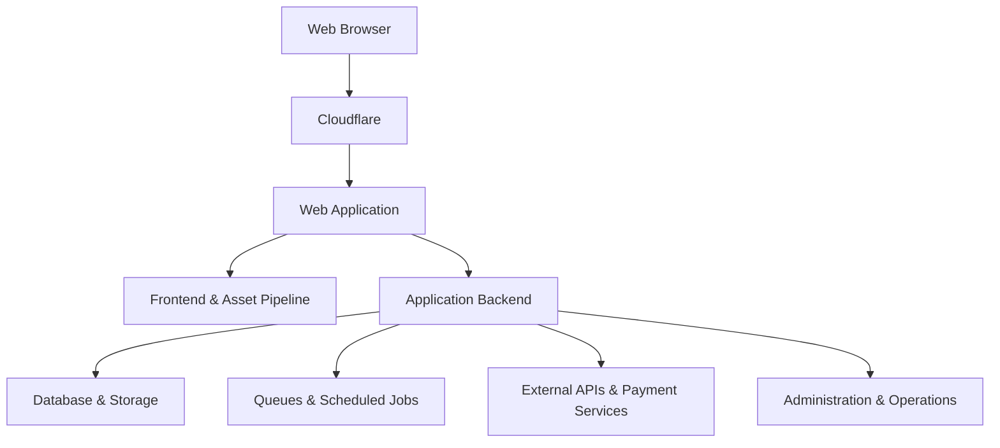

# RocoShop

### Multi-Stack Digital Commerce Platform

**A production web platform built across multiple technologies, integrated services, and automated operations.**

---

## Overview

RocoShop is a digital commerce platform designed for publishing, managing, and distributing digital products.

The system combines server-side application logic, interactive frontend components, database-backed workflows, external service integrations, and deployment automation.

Laravel is part of the backend foundation, but the overall platform operates across multiple programming languages, tools, and infrastructure components.

The engineering work covers both product development and ongoing production operations.

## Platform Capabilities

| Area | Implementation |
|---|---|
| Digital Commerce | Product catalog, publishing workflows, and product management |
| Customer Accounts | Authentication, account management, and identity workflows |
| Payments | Checkout processing and payment gateway integration |
| Content & Media | Product images, generated share assets, and social media links |
| Integrations | External APIs and third-party service connections |
| Background Operations | Database-backed queues and scheduled processing |
| Administration | Product management and operational workflows |
| Production Delivery | Asset builds, Cloudflare integration, and deployment automation |
| Operations | Health checks, troubleshooting, and release verification |

## Technology Ecosystem

The platform incorporates technologies serving different responsibilities.

**Application & Data**

**Frontend & Asset Pipeline**

**Infrastructure & Engineering**

Different technologies are used for different responsibilities rather than forcing the entire platform into a single technology stack.

## Architecture Overview

The following diagram illustrates the platform's major responsibilities at a high level. It is not a detailed production infrastructure map.

## Engineering & Operations

### Application Development

The application combines backend business logic with interactive web interfaces and database-backed functionality.

### Integration Engineering

Product-related workflows connect with external services, authentication providers, payment systems, and content distribution channels.

### Deployment Workflow

Production delivery uses Git-based release workflows, application preparation, validation checks, and rollback planning.

### Reliability & Maintenance

Ongoing work includes production troubleshooting, runtime health checks, application monitoring, and maintenance of existing features.

## Security & Design Considerations

Engineering priorities include:

- Authentication and authorization boundaries
- Secure handling of customer and payment workflows
- Controlled production deployments
- Data integrity and input validation
- Recovery planning and operational observability

These are engineering focus areas, not claims of independent security certification.

## Live Platform

RocoShop is publicly accessible:

**[rocoshop.ir](https://rocoshop.ir)**

The live website demonstrates the customer-facing experience. Administrative features and internal services are not publicly accessible.

## Repository Scope

This repository is a public technical showcase of a proprietary commercial platform.

It does not include the production source code, private integrations, credentials, infrastructure configuration, or customer data.

The documentation is intended to present the platform's engineering scope without exposing its internal implementation.

---

**Developed & Maintained by ARIA ZEUS**

Software Engineer · Full-Stack Developer

ZEUS Development Team

[GitHub Profile](https://github.com/ARIA-ZEUS) · [Visit RocoShop](https://rocoshop.ir)

