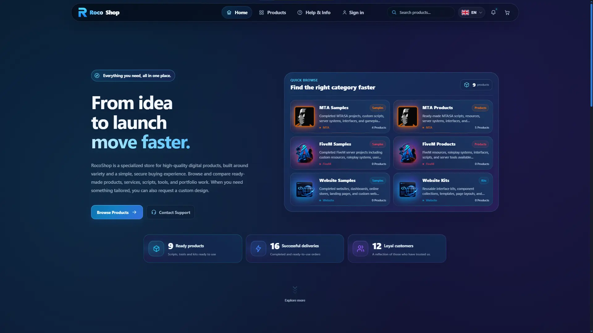
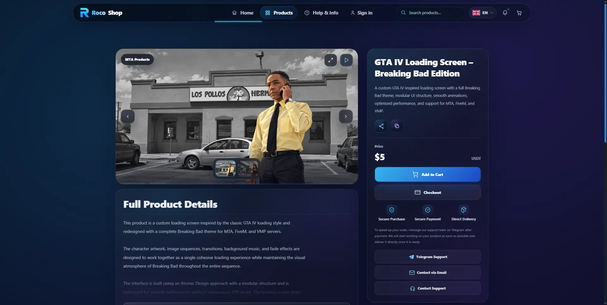
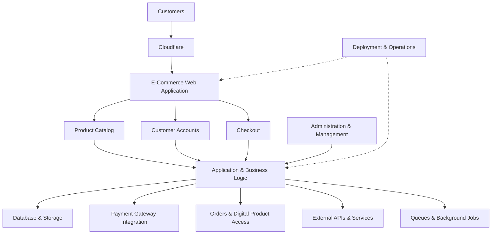

# RocoShop

### Polyglot E-Commerce Platform

**A multi-technology commerce platform built around digital products, secure transactions, custom integrations, and production automation.**

---

## Overview

RocoShop is a digital commerce platform developed to manage the complete lifecycle of digital products, from catalog management and publishing to customer accounts, checkout, and distribution.

Originally developed with PHP, the platform has evolved into a polyglot codebase that brings together multiple programming languages, application frameworks, custom APIs, and automated operational workflows.

Laravel remains an important part of the backend foundation, while supporting technologies address specialized application, administrative, and integration requirements.

The project is designed around maintainable business logic, secure customer workflows, operational reliability, and continuous development.

**Engineering Focus:** E-commerce architecture, backend engineering, API integration, authentication, payment workflows, automation, and production operations.

## Platform Preview

### Homepage — Commerce & Product Discovery

A responsive storefront featuring product categories, navigation, search, and a unified digital commerce experience.

### Product Detail — Shopping Experience

A product detail interface featuring an image gallery, product information, pricing, shopping cart actions, and checkout access.

## E-Commerce Capabilities

| Area | Capabilities |
|---|---|
| Product Catalog | Digital product organization, publishing, and catalog management |
| Product Administration | Product creation, editing, configuration, and management workflows |
| Customer Accounts | Registration, authentication, account management, and identity integrations |
| Checkout & Payments | Checkout workflows, transaction handling, and payment gateway integration |
| Digital Distribution | Product access and distribution workflows |
| API Integrations | Custom application APIs and external service integrations |
| Administration | Operational dashboards, administrative controls, and management tools |
| Security | Authorization boundaries, account protection, and input validation |
| Background Jobs | Queue-backed operations, scheduled tasks, and automated processing |
| Data Management | Structured data storage, application records, and data integrity |
| Production Operations | Deployment automation, application health checks, and troubleshooting |

## Technology Ecosystem

RocoShop uses multiple technologies to support its commerce functionality.

The technologies listed below represent different responsibilities within the codebase and development workflow. They do not imply that every component is deployed as an independent production service.

### Backend & Application Development

The application combines PHP/Laravel business logic with supporting Python-based development and Django components.

Backend responsibilities include:

- Product and catalog management
- Customer account workflows
- Checkout and payment integrations
- Administrative functionality
- Custom API development
- Background operations
- Business-rule implementation

### Frontend & User Experience

Frontend engineering focuses on commerce-oriented interfaces, including:

- Product discovery and navigation
- Product detail pages
- Customer account interfaces
- Checkout usability
- Responsive layouts
- Administrative interfaces
- Frontend asset optimization

### Database & Application Data

Data management supports product information, customer records, transaction-related workflows, and application state.

Engineering priorities include data integrity, reliable persistence, controlled database changes, and maintainable data access patterns.

### API Engineering & Integrations

Custom APIs and service integrations connect commerce workflows with supporting systems.

Relevant areas include:

- Payment gateway integrations
- External authentication providers
- Account-related integrations
- Administrative API endpoints
- Third-party business services
- Cross-component communication
- Integration error handling

The integration layer is designed to keep external dependencies manageable within the broader application.

### Infrastructure & Deployment

Infrastructure and delivery engineering includes:

- Git-based source management
- Automated deployment workflows
- Frontend asset builds
- Application configuration management
- Controlled releases
- Rollback planning
- Cloudflare integration
- Runtime health checks
- Production troubleshooting

## E-Commerce Architecture

RocoShop combines customer-facing commerce functionality with backend business logic, administrative systems, persistent data, and external integrations.

The diagram below illustrates the platform's functional responsibilities at a high level. It is not a detailed representation of the private production infrastructure.

The architecture focuses on coordinating business operations through a consistent application environment while allowing specialized components to support particular responsibilities.

## Engineering & Operations

### E-Commerce Application Development

RocoShop's application layer manages core commerce functionality, including product administration, customer workflows, checkout, and digital product access.

The platform has evolved beyond its original PHP implementation while retaining a coordinated approach to business logic.

### Authentication & Account Management

Account-related engineering includes:

- Authentication workflows
- Authorization and access controls
- External identity provider integrations
- Account management
- Administrative access boundaries
- Session and account security considerations

### Payment Integration

Checkout and payment functionality integrates commerce workflows with external payment services.

Engineering priorities include transaction integrity, authorization, validation, error handling, and consistent application state.

### API & Integration Development

Custom APIs connect internal application components and external business services.

The goal is to provide maintainable integrations while preserving separation between commerce logic and external dependencies.

### Administration & Operations

Administrative functionality supports day-to-day platform management.

Areas of development include:

- Product publishing and maintenance
- Administrative workflows
- Account-related management
- Application configuration
- Operational troubleshooting
- Internal management tools

### Automation & Deployment

Production delivery incorporates version-controlled releases, application preparation, automated operations, and verification procedures.

Deployment workflows are designed to support controlled updates and reduce operational risk.

## Security & Reliability

Security and reliability are central engineering priorities.

The platform's development practices focus on:

- Authentication and authorization
- Administrative access protection
- Secure checkout and payment integrations
- Input validation
- Data integrity
- Sensitive information handling
- Controlled deployments
- Runtime diagnostics
- Operational recovery planning

These describe engineering priorities and implemented areas of work, not an independent security certification.

## Live Platform

RocoShop is publicly accessible at:

### [rocoshop.ir](https://rocoshop.ir)

The live platform demonstrates the customer-facing commerce experience.

Administrative workflows, internal APIs, and private infrastructure are not fully visible through the public website.

## Repository Scope

This repository serves as a public technical showcase of RocoShop.

RocoShop is a proprietary commercial software platform. Its implementation includes private application code, integrations, administrative systems, and operational infrastructure.

**The production source code is not distributed through this repository.**

This showcase excludes:

- Proprietary application source code
- Private API implementations
- Credentials and authentication secrets
- Internal infrastructure configuration
- Customer and transaction data
- Confidential operational information

---

### Developed & Maintained by ARIA ZEUS

**Software Engineer · Full-Stack Developer**

ZEUS Development Team

[GitHub Profile](https://github.com/ARIA-ZEUS) · [Visit RocoShop](https://rocoshop.ir)

